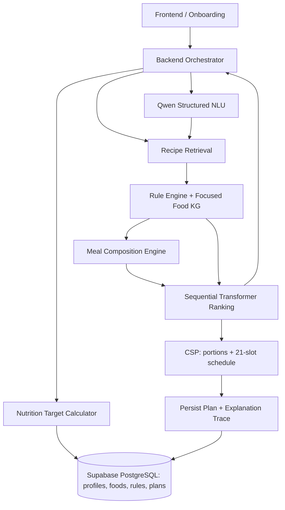
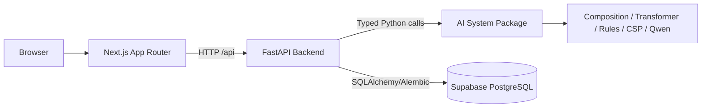

# ARCHITECTURE.md — Savora GC1 System Architecture

**Status:** Implementation baseline for team review. **Project:** Savora — Explainable Neuro-Symbolic Meal Planning. **Team:** 3 developers; approximately 10 person-days each. This document supersedes earlier informal design discussions when explicitly approved by the team.

## 1. Product scope
Savora onboards users, computes and stores versioned nutrition targets, generates a seven-day plan (21 breakfast/lunch/dinner slots), supports independent craving-based recipe discovery, and allows a user to request a replacement for a saved plan slot. Store generated plans and substitutions only. Do **not** implement ratings, consumption tracking, accept/reject feedback, craving event history, continuous learning, or automatic model retraining in GC1.

Supported profile concerns: diet patterns (vegetarian, vegan, etc.), explicit cultural ingredient exclusions, allergies/intolerances, cuisine preferences (strict/majority/mixed), and the three scoped conditions: type 2 diabetes, hypertension, and dyslipidemia. Do not infer restrictions from religion or ethnicity without user confirmation. Clinical thresholds must be sourced, versioned, and scoped; uncertain safety-critical data fails closed.

## 2. Component map



The direct `RULE → RANK → API` branch is **standalone craving discovery** only. Weekly planning and saved-slot substitution use `RULE → COMP → RANK → CSP`.

## 3. Canonical concepts and invariants
- **Ingredient:** canonical food entity with allergen/derivation relationships.
- **Recipe/dish:** complete preparation with ingredient list, cuisine/role tags, nutrition reference, confidence and provenance. Some dishes are complete meals; others require accompaniments.
- **Portion definition:** recipe-specific household measure (`piece`, `bowl`, `cup`, `slice`, `loaf`, `g`, `mL`) mapped to reference mass/volume. No universal bowl/piece weight.
- **Meal combination:** a composition of one or more recipes with contextual culinary roles (staple, main, vegetable, breakfast base, supplement, etc.). Composition is independent of final portion quantities.
- **Portion configuration:** explicit quantities for each component, converted to canonical mass and nutrition totals.
- **Meal slot:** `D1_BREAKFAST` through `D7_DINNER`, one chosen combination and portion configuration per slot.
- **User nutrition profile:** versioned daily targets and source/method metadata, computed at onboarding and recomputed on relevant profile changes, not on every plan request.
- **Plan snapshot:** saved immutable representation of assigned dishes, quantities, nutrition, target version and model/rule versions. New generation creates a new plan; substitutions preserve original and replacement snapshots.
- `PASS | FAIL | UNKNOWN` is required for safety-related eligibility; UNKNOWN never becomes PASS by model preference.
- Missing nutrition required by an active hard rule cannot be treated as zero.

## 4. End-to-end workflows

### 4.1 Onboarding
1. Frontend collects age, sex where relevant to the documented estimator, height, weight, activity, goals, allergies, conditions, diet, explicit exclusions, cuisine policy and preferences.
2. Backend validates and normalizes profile fields. NLU is not a substitute for explicit safety-critical confirmation.
3. Nutrition Target Calculator applies a named resting-energy equation, activity factor, documented goal adjustments, and applicable sourced KB rules. BMI is informational, not an energy formula.
4. Backend persists the user profile and **versioned** daily target snapshot; frontend displays targets and provenance.
5. Recompute when relevant profile fields change; retain old target versions for plan reproducibility.

### 4.2 Generate a weekly plan
1. Load user profile and stored target version.
2. Retrieve candidate dishes by meal type, cuisine policy and metadata; Rule Engine excludes ineligible/unknown-safety dishes.
3. Composition Engine builds plausible complete meals using curated templates and compatible roles. Revalidate entire combinations for hidden ingredients and applicable hard rules.
4. Transformer ranks eligible **combination IDs**; it does not invent ingredients, nutrition, or portions.
5. CSP selects a combination and discrete portions for each of 21 slots, honoring meal/daily/weekly constraints. Persist only a fully validated plan; otherwise return explicit infeasibility/timeout.
6. Explanation assembler combines rule, rank, composition and CSP traces; save plan snapshot.

### 4.3 Standalone craving recommendation


Bypass Meal Composition and weekly CSP. Never bypass dietary/allergen or recipe-specific hard clinical restrictions. Show standard, verified serving nutrition; **do not claim** that a craving recommendation fits remaining daily nutrient budgets. If no useful interaction history exists, use documented content/popularity fallback. Qwen extracts intent; it does not select safe recipes or invent hard rules.

### 4.4 Saved-plan meal substitution
1. Qwen parses `SWAP_MEAL`, target slot and desired attributes; ask for clarification if slot/intent is ambiguous.
2. Load saved plan and freeze the other 20 assignments, including their portions and nutrient totals.
3. Run full retrieval → rules → composition → Transformer → CSP/portion feasibility pipeline for the replacement.
4. Validate all affected day and weekly constraints with locked slots; do not silently alter other meals.
5. On success, persist substitution with before/after snapshots and update the plan's effective view transactionally. On failure return explicit no-feasible-replacement.

## 5. Knowledge and nutrition policy
Supabase PostgreSQL is the source of truth; use relational food-edge tables and optional NetworkX traversal for the **focused** KG. No dedicated graph DB required for GC1.

KB domains:
- **Diet/culture:** vegetarian, vegan, explicit Indian/Chinese vegetarian templates and optional tradition-specific exclusions requiring user confirmation. Religion is not a deterministic proxy for diet.
- **Cuisine:** multi-label hierarchy (Indian/North/South Indian, Nepali, Chinese, Thai, etc.). `STRICT` limits eligible cuisines; `MAJORITY` constrains approximate weekly share; `MIXED` allows diversity. Define rounding/tolerance before coding.
- **Food graph:** `CONTAINS`, `DERIVED_FROM`, `HAS_CULINARY_ROLE`, `COMPATIBLE_WITH`, `FUNCTIONAL_SUBSTITUTE_FOR` with curated evidence.
- **Clinical:** applicable sourced daily/recipe rules for sodium, saturated fat, protein, carbohydrate, potassium, caffeine, etc. Do not apply generic potassium/caffeine bans merely because of hypertension; account for missing clinical context.
- **GI/GL:** store source-backed food-specific GI when known; GL may be derived from GI and available carbohydrates, but do not claim accurate mixed-meal glycemic prediction. Unknown GI remains unknown.
- **Portions:** recipe-specific conversions and discrete allowed ranges, with provenance and confidence.

Rules store `ruleId`, `scope`, `severity`, `population/applicability`, `attribute`, `operator`, `value/unit`, `source/version`, and `rationale`. Distinguish absolute/hard constraints from soft targets and informational guidance. The team must verify clinical references before activating numeric limits.

## 6. Meal Composition Engine
Owned by Member 1. Operates on **complete recipes/dishes**, not raw ingredient-level recipe synthesis. Tag dishes as `COMPLETE_MEAL`, `REQUIRES_ACCOMPANIMENT`, or `COMPONENT`; assign contextual, potentially multiple roles. Use a bounded curated template catalogue (e.g., staple + curry + optional vegetable; breakfast base + optional protein/fruit). Retrieve compatible candidates, deduplicate, check cultural/cuisine requirements, then send complete combination IDs to the Rule Engine for final eligibility and to Transformer for ranking. Never assume a template is universal; one-dish meals remain valid. Do not set final quantities.

## 7. Transformer ranking and model limitations
Train a compact sequential model on **chronological Food.com recipe interactions**, with leakage-safe splits. These are interactions, not verified consumed breakfast/lunch/dinner sequences. Evaluate popularity, similarity and Markov baselines against Transformer (HR@K, NDCG@K, MRR and diversity).

Public functions:
```python
rank_recipes(history_recipe_ids, candidate_recipe_ids, user_context)
rank_combinations(history_recipe_ids, candidate_combination_ids, user_context)
```

`rank_combinations` uses a documented aggregation of dish-level representations/scores unless valid combination-level training data becomes available. Scores are relative rankings, not calibrated nutrition or clinical estimates. Never score outside the supplied safe IDs. No actual history → documented content/popularity fallback. Saved generated plans must not be misrepresented as user consumption or positive feedback.

## 8. CSP and portions
- Variables: 21 slots, each value = `(combinationId, portionConfiguration)`.
- Candidate portion ranges are **recipe-specific** and discretized (e.g., pieces or 50 g steps); internal mass uses grams where appropriate; convert liquids using validated density/reference measures.
- Calculate component and meal nutrition deterministically from validated reference quantities. Maintain nutrient lower/upper remaining budgets, not merely a single subtraction from a target.
- Constraints: allergy/diet/clinical hard rules, allowed portion ranges, meal allocation guidelines, daily energy/protein/carbohydrate/fat/sodium etc., weekly repetition and cuisine policy.
- Avoid early slots exhausting budgets: after provisional assignment, check current totals plus minimum/maximum attainable nutrients in remaining slot domains; backtrack if impossible. These bounds are necessary pruning tests, not proof of joint feasibility.
- Implement baseline chronological backtracking, forward checking, MRV variant and Transformer-guided value ordering. MRV does not preserve chronological assignment; keep **observed user history** separate from provisional planning assignments. Do not assume a Food.com-trained Transformer understands provisional meal sequences.
- Record nodes, backtracks, runtime, feasibility, hard violations and preference objective. A first-feasible plan is not necessarily globally optimal; report the search criterion honestly.

## 9. Shared API and JSON contracts
HTTP wire JSON uses `camelCase`; Python and SQL use `snake_case`. Validate with Pydantic v2/Zod. HTTP success envelope `{success, source, data, message, status}`; error envelope `{success:false, source, message, status, description?}`. Internal service calls may use typed objects rather than HTTP envelopes.

### 9.1 Qwen normalized craving request
```json
{
  "intent": "CRAVING_RECOMMEND",
  "cuisineIds": ["CHINESE"],
  "flavorTags": ["SPICY"],
  "excludedIngredientIds": ["NOODLES"],
  "mealSlotId": null,
  "requiresClarification": false
}
```
`SWAP_MEAL` requires a valid saved plan and slot. Normalization must not mistake a dish exclusion for a clinical allergen.

### 9.2 Transformer output (raw)
```json
{
  "slotId": "D2_LUNCH",
  "rankedCandidates": [
    {"combinationId": "COMBO_101", "rank": 1, "score": 0.94},
    {"combinationId": "COMBO_102", "rank": 2, "score": 0.87}
  ],
  "modelVersion": "transformer-v1"
}
```
Craving ranking uses `recipeId` rather than `combinationId`. Scores are illustrative. Raw Transformer output does **not** contain nutrition or portion claims.

### 9.3 Enriched candidate for CSP (assembled by orchestration/data layer)
```json
{
  "slotId": "D2_LUNCH",
  "dailyTargetVersion": 1,
  "slotCandidates": [{
    "combinationId": "COMBO_101",
    "rank": 1,
    "transformerScore": 0.94,
    "ruleStatus": "PASS",
    "components": [
      {"recipeId": "DAL_001", "role": "MAIN_DISH", "nutritionPer100g": {"energyKcal": 115, "proteinG": 7, "sodiumMg": 175}, "portionOptionsG": [150, 200, 250]},
      {"recipeId": "RICE_001", "role": "STAPLE", "nutritionPer100g": {"energyKcal": 130, "proteinG": 2.7, "sodiumMg": 5}, "portionOptionsG": [100, 150, 200]}
    ]
  }]
}
```
Illustrative nutrient values only. Production contract must include all nutrients required by active rules, completeness status, reference preparation/portion and provenance. CSP selects quantities; orchestration enriches IDs with verified data.

### 9.4 Planning output
```json
{
  "status": "FEASIBLE",
  "planId": "PLAN_101",
  "targetVersion": 1,
  "slots": [{"slotId": "D2_LUNCH", "combinationId": "COMBO_101", "portions": [{"recipeId": "DAL_001", "grams": 200}, {"recipeId": "RICE_001", "grams": 150}], "nutrition": {"energyKcal": 425}}],
  "traceId": "TRACE_101"
}
```
The complete result must contain 21 slots. Alternatives: `INFEASIBLE`, `TIMEOUT`, `INSUFFICIENT_DATA` with reasons. No silent relaxation of hard constraints.

## 10. Persistence
Use Supabase PostgreSQL with Alembic migrations and indexes (local Docker Compose PostgreSQL is optional for offline testing). Core entities: `users`, `user_profiles`, `user_nutrition_profiles`, `recipes`, `ingredients`, `recipe_ingredients`, `nutrition_references`, `portion_definitions`, `food_entities`, `food_relations`, `dietary_rules`, `meal_templates`, `meal_combinations`, `meal_combination_components`, `meal_plans`, `meal_plan_slots`, `meal_plan_substitutions`. Schema can be simplified where a curated catalogue suffices. Persist immutable plan/portion/nutrition snapshots so later recipe updates do not rewrite history. Generated plans and substitutions only; no feedback/consumption event table in GC1.

## 11. Developer ownership and dependencies
| Developer | Owns | Consumes | Delivers |
|---|---|---|---|
| **Member 1 — Project lead** | Food.com/USDA normalization, portion definitions/unit conversion, cuisine/culinary-role tagging, Meal Composition Engine, nutrition target **calculation code**, sequential Transformer, ranking APIs, baselines, XAI aggregation | Member 2 canonical KB concepts, sourced nutrition rules and eligibility API; Member 3 canonical profile schema | Verified recipe catalogue, `calculate_nutrition_targets`, `generate_meal_combinations`, `rank_recipes`, `rank_combinations`, evaluation and explanation builder |
| **Member 2 — Symbolic reasoning** | Dietary/cultural/clinical Rule KB, focused KG, deterministic Rule Engine, CSP with discrete portion optimization, search evaluation | Member 1 normalized recipes/portions/combinations and ranking API; Member 3 profile and plan/slot requests | `filter_candidates`, combination validation, `solve_week`, `validate_swap`, rule/search traces, curated safety tests |
| **Member 3 — Interaction** | Next.js UI, onboarding, profile persistence/display, Qwen intent extraction and canonical normalization, craving orchestration, plan/substitution persistence | Member 1 target/ranking/composition APIs; Member 2 rule/CSP APIs | `parse_craving`, onboarding UI, 21-slot planner UI, craving results, saved-plan and swap flows, NLU evaluation |

Member 1 implements the target *calculator*; Member 2 owns authoritative clinical rule definitions and their applicability. Member 3 owns backend persistence/orchestration of plans, not nutrition or safety decisions. Shared DTOs/IDs must be approved jointly.

## 12. Repository topology and engineering stack
Use the existing repository layout if already established. Proposed clean monorepo:
```text
apps/
  backend/       # FastAPI, Pydantic v2, SQLAlchemy 2, Alembic, persistence/orchestration
  frontend/      # Next.js App Router + TypeScript, Tailwind, Zod, React Query
  ai_system/     # data, nutrition_calculator, composition, recommender, rules, kg, csp, nlu, xai, evals
packages/contracts/ # OpenAPI-generated TS types, schema examples and contract fixtures
docs/            # ADRs, clinical evidence, evaluation reports
AGENTS.md
ARCHITECTURE.md
```
Supabase PostgreSQL is sufficient; NetworkX is optional for small KG traversal. Use Qwen for structured NLU only. No vector DB, Redis, or Neo4j is required for MVP. Backend services orchestrate AI components via typed interfaces; do not require network microservices unless existing deployment warrants them.

### 12.1 Monorepo runtime and ownership (approved)



- **Next.js** owns route layouts and UI; `src/app` contains thin route entry points and `src/core` contains feature code. Server Components by default, client components for interactive forms/chat/React Query. Do not use Vite or React Router.
- **FastAPI** is the sole authoritative application API and database writer (connecting to Supabase PostgreSQL via async SQLAlchemy 2 and Alembic; Next.js never queries Supabase directly). Use controller → service → repository modules, Pydantic v2 camelCase DTO aliases, consistent response/error envelopes, request context and migrations.
- **AI package** is imported into the backend runtime, not deployed as a separate microservice. AI algorithms take validated domain inputs and return typed outputs; they do not import backend ORM models or manage transactions.
- **Cross-language contracts** live as versioned OpenAPI definitions, generated TypeScript types and fixture examples in `packages/contracts`. Python Pydantic schemas are authoritative for HTTP contracts; avoid hand-maintained duplicate TS types.
- **Frontend pattern:** feature-level `.api.ts` endpoint definitions, `.query.ts` React Query hooks, Zod schemas and React Hook Form. Avoid duplicate business logic in Next.js route handlers/server actions.
- **Developer module ownership** remains as in §11. Member 3 owns Next.js and FastAPI app integration; Members 1/2 own their respective AI capability packages.
- **Infrastructure:** pnpm workspace (frontend), uv workspace (backend and AI), Supabase PostgreSQL (with optional Docker Compose local fallback), Makefile and CI. No additional runtime infrastructure is required for GC1.

## 13. Testing, evaluation and acceptance
- **Rule/KG:** curated vegetarian, vegan, no-pork/beef, peanut, derived ingredient, unknown-ingredient and clinical cases; zero known hard-rule violations.
- **Nutrition/portion:** unit conversions, missing values, profile recalculation, daily target provenance and deterministic per-portion totals.
- **Composition:** complete-meal and accompaniment templates, contextual roles, culturally valid/invalid pairs, deterministic bounded candidate counts.
- **Transformer:** leakage-safe Food.com splits; popularity/similarity/Markov baselines; HR@K/NDCG@K/MRR/diversity and combination-scoring ablation.
- **CSP:** chronological baseline vs forward checking vs MRV vs Transformer ordering; equal candidate sets and stopping criteria; runtime/nodes/backtracks/feasibility/objective; explicit infeasibility.
- **NLU:** template baseline vs Qwen; intent accuracy, slot F1, schema validity, ambiguity behavior and latency.
- **End-to-end:** onboarding → stored targets → feasible 21-slot plan; standalone craving → safe recipe recommendations without CSP; substitution → full pipeline, locked slots, saved before/after snapshot.

## 14. Delivery order and scope guardrails
1. Freeze shared IDs/DTOs and a curated verified recipe subset.
2. Build nutrition profile, dietary rules and a one-day (3-slot) baseline solver using fake ranking.
3. Add composition templates and trained/baseline Transformer ranking.
4. Expand to 21 slots; add CSP search variants, explanations and persistence.
5. Integrate Qwen craving and saved-slot substitution; run experiments and report.

**Non-goals:** full FoodOn import, arbitrary ingredient-level recipe synthesis, automatic clinical diagnosis, guarantee of medical suitability, continuous user-feedback learning, optimization of standalone cravings, or silent changes to locked plan slots.

## 15. Open decisions requiring explicit team approval
- Exact sourced numeric clinical rules, target estimator/activity factors and handling of special populations.
- Supported recipe catalogue size, validated portion conversion sources, and minimum nutrition completeness.
- Exact meal templates, cuisine tagging policy, strict/majority distribution rounding, and optional snack handling (not in current 21-slot scope).
- Combination-score aggregation and whether provisional planning history is used (default: **observed history only**).
- CSP search timeout, candidate cap, and whether to return first feasible or optimize a bounded preference objective.

Do not turn these open items into undocumented assumptions. Record decisions as short ADRs in `docs/`.
