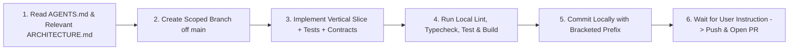

# Agentic Engineering & GitHub PR Workflow Guide

This document defines the complete **Agentic Development, CI/CD, and Pull Request Code Review Workflow** used in this repository. It serves both as the operational handbook for contributors/agents in this repo and as a **reusable blueprint** that any coding agent (Antigravity, Claude Code, Cursor, GitHub Copilot, Codex, Windsurf) can follow to replicate this setup in other projects.

---

## 1. Core Design Principles

1. **Agent-Agnostic & Team-Wide Portability**
   - All project rules, scripts, and CI pipelines use standard, portable CLI tools (`git`, `uv`, `pnpm`, `make`, `gh`) with zero machine-specific binary wrappers (like `.tools/`) committed to git.
   - Shared domain skills live in `.agents/skills/` and are **tracked in git** so every team member gets the exact same project skills (e.g., `supabase`, `supabase-postgres-best-practices`).
2. **Token-Efficient Rules (`AGENTS.md`)**
   - Because `AGENTS.md` is injected into the context window on **every turn**, keep `AGENTS.md` concise (~40–50 lines, `< 800` tokens).
   - Store deep domain specifications in `ARCHITECTURE.md` and specialized reference guides in `.agents/skills/`, instructing agents to load only what is relevant to their current task.
3. **Strict Public-Repository Secret Hygiene**
   - Track only `.env.example` with generic placeholders (`<YOUR-SUPABASE-PROJECT-REF>`, `<YOUR-DB-PASSWORD>`, `<CHANGE-ME-GENERATE-WITH-OPENSSL-RAND-HEX-32>`).
   - Never hardcode project refs, hostnames, or credentials in `alembic.ini`, `README.md`, or PR descriptions.
   - Enforce a CI guard that fails immediately if any `.env` file (other than `.env.example`) is tracked in git.
4. **Human-in-the-Loop Git & PR Gate**
   - Agents never commit, push, or merge directly to `main`.
   - Agents work on scoped branches, run all local verification gates, commit locally with bracketed prefixes, and **wait for explicit user instruction** before pushing or opening a Pull Request.

---

## 2. Repository Governance & File Layout

To set up this workflow in any repository, create and maintain these exact files:

```text
.
├── AGENTS.md                           # Compact (~45 lines) universal rules read on every turn
├── ARCHITECTURE.md                     # Detailed system architecture & module ownership
├── .agents/
│   └── skills/                         # Shared team agent skills (tracked in git, no changelog bloat)
├── .env.example                        # Safe placeholder environment template (tracked)
├── .gitignore                          # Blocks .env* and keys/certs while tracking .agents/
├── docs/
│   └── AGENT_WORKFLOW.md               # This workflow & replication guide
└── .github/
    ├── PULL_REQUEST_TEMPLATE.md        # Mandatory 5-section PR description template
    ├── copilot-instructions.md         # Instructions for native GitHub Copilot PR Code Review
    └── workflows/
        ├── ci.yml                      # Lint, typecheck, test, build & boundary checks
        └── pr-review.yml               # Automated governance gate & line-by-line diff reviewer
```

---

## 3. End-to-End Agent Execution Workflow

Every coding agent working on a task must follow these 6 phases in order:



### Phase 1: Context & Ownership Discovery
1. Read `AGENTS.md` completely.
2. Read **only** the relevant section(s) of `ARCHITECTURE.md` for the target feature/slice.
3. Identify:
   - Package owner (`apps/frontend`, `apps/backend`, `apps/ai_system`, `packages/contracts`)
   - Input/output DTOs and database impact
   - Domain/safety invariants that apply

### Phase 2: Branching Strategy (Never Work on `main`)
1. Check current branch (`git branch --show-current`).
2. If on `main` (or finishing a prior merged PR), sync `main` and create a new descriptive branch:
   ```bash
   git checkout main
   git pull origin main
   git checkout -b <type>/<scope>-<short-description>
   ```
   Allowed branch prefixes:
   - `feat/<scope>-<desc>` (new vertical slice or feature)
   - `fix/<scope>-<desc>` (bug fix)
   - `refactor/<scope>-<desc>` (internal restructuring without behavior change)
   - `chore/<scope>-<desc>` (CI, tooling, dependencies, docs)

### Phase 3: Implementation & Boundary Enforcement
- **Dependency Direction:** `apps/frontend` → `apps/backend` → `apps/ai_system`.
  - `apps/ai_system` must **never** import `savora_backend`, `fastapi`, `sqlalchemy`, or DB drivers.
  - `apps/frontend` components/pages must **never** call `axios` or `fetch` directly; use `.api.ts` → `.query.ts` (TanStack React Query) → component.
- **Database Changes:** Any change to SQLAlchemy entities in `apps/backend` requires an Alembic migration in `apps/backend/alembic/versions/`.
- **API Contract Changes:** Any change to FastAPI request/response DTOs requires regenerating `packages/contracts` (`make contracts`).

### Phase 4: Local Verification Gate (Mandatory Before Commit)
Run all relevant checks locally and fix any errors before creating a commit:

```bash
# Python workspace (apps/backend + apps/ai_system)
uv run ruff check .
uv run pyright
uv run pytest -q

# JS/TS workspace (apps/frontend + packages/contracts)
pnpm lint
pnpm typecheck
pnpm build
```

### Phase 5: Bracketed Commit Convention
1. Verify `git status -s` to ensure no `.env`, credentials, or build artifacts are staged.
2. Commit using one of the mandatory bracketed prefixes:
   - `[ADD]: <concise imperative summary>`
   - `[UPDATE]: <concise imperative summary>`
   - `[FIX]: <concise imperative summary>`
   - `[REFACTOR]: <concise imperative summary>`
   - `[DELETE]: <concise imperative summary>`

### Phase 6: Push & Pull Request Creation (On User Instruction Only)
1. **Wait for explicit user instruction** before pushing or creating a PR.
2. When instructed by the user:
   - Push the branch to `origin`:
     ```bash
     git push -u origin <branch-name>
     ```
   - Prepare a complete PR body following `.github/PULL_REQUEST_TEMPLATE.md` with **all 5 sections filled out** (no empty sections or placeholder comments):
     1. `## Summary & Motivation`
     2. `## Architecture & Ownership` (with `[x]` checked workspaces)
     3. `## Key Changes` (module-by-module breakdown)
     4. `## Savora Invariants Checklist` (with `[x]` verified items)
     5. `## Verification Executed` (exact commands run and results)
   - Open the Pull Request against `main`:
     ```bash
     gh pr create --base main --title "[PREFIX]: <summary>" --body-file <pr-body.md>
     ```
3. **Never merge the PR automatically** — leave merging to human review on GitHub.

---

## 4. GitHub Actions CI & Automated Code Review Setup

### 4.1 Continuous Integration (`.github/workflows/ci.yml`)
Runs on every `push` to `main` and every `pull_request` targeting `main`:
- **Concurrency:** Cancels superseded runs on the same branch/PR.
- **Python Job:**
  1. `uv sync --locked`
  2. **Secret Leak Guard:** Fails if any `.env` file (other than `.env.example`) is tracked in git.
  3. **AI Boundary Check:** Fails if `apps/ai_system/src/` imports `savora_backend`, `fastapi`, or `sqlalchemy`.
  4. `uv run ruff check .`
  5. `uv run pyright`
  6. `uv run pytest -q`
  7. `make contracts`
- **Frontend Job:**
  1. `pnpm install --frozen-lockfile` (requires `"packageManager": "pnpm@<version>"` in root `package.json`).
  2. **Frontend Layer Check:** Fails if `apps/frontend/src/app/` imports `axios` directly.
  3. `pnpm lint`
  4. `pnpm typecheck`
  5. `pnpm build`

### 4.2 Automated PR Reviewer (`.github/workflows/pr-review.yml`)
Runs on `pull_request` (`opened`, `synchronize`, `reopened`, `edited`):
1. **8-Point Deterministic Governance Gate:**
   - Commit prefix convention (`[ADD]:`, `[UPDATE]:`, `[FIX]:`, `[REFACTOR]:`, `[DELETE]:`)
   - PR description completeness (`Summary`, `Key Changes`, `Verification`)
   - Secret / `.env` protection
   - `apps/ai_system` import isolation
   - `apps/frontend` framework & API layering
   - Single-datastore invariant
   - Entity vs. Alembic migration sync
   - `package.json`/`pnpm-lock.yaml` and `pyproject.toml`/`uv.lock` sync
2. **Line-by-Line Diff Inspector & Inline Comments:**
   - Parses unified diff hunks (`@@ ... +line @@`) to map every added line to its exact `{ path, line }`.
   - Posts a **Per-File Line-by-Line Walkthrough** table in a sticky PR comment (`<!-- savora-pr-reviewer -->`).
   - Attaches **inline review comments** directly onto violating lines in the *"Files changed"* tab via `github.rest.pulls.createReview`.
   - Automatically requests GitHub's native `copilot-pull-request-reviewer[bot]` when available.

### 4.3 GitHub Repository Ruleset Configuration (`Settings → Rules → Rulesets`)
Configure a Branch Ruleset targeting `main` (`Active`):
- ✅ **Require a pull request before merging**
  - **Required approvals:** `0` (if solo / automated gate) or `1` (when requiring a human teammate's approval; note that bots/Copilot only leave `Comment` reviews and never count as write-access approvers).
  - ✅ **Automatically request Copilot code review** (with **Review new pushes** enabled; requires GitHub Copilot Pro / GitHub Education on the author's account).
- ✅ **Require status checks to pass**
  - Add required checks:
    - `Python (ruff, pyright, pytest, architecture boundaries)`
    - `Frontend (eslint, tsc, next build)`
    - `Automated Architecture & Line-by-Line Review`
- ✅ **Block force pushes** (protects `main` history)

---

## 5. Prompt to Replicate This Setup in Any Other Project

Copy and paste the prompt below into any AI coding agent to set up this exact workflow in another repository:

```markdown
Set up our repository governance, secret protection, and GitHub PR workflow following these exact standards:

1. Root `AGENTS.md` (keep under 50 lines to minimize per-turn token usage):
   - Define module boundaries and dependency direction.
   - Enforce Git & PR workflow:
     - Never commit, push, or merge directly to `main`; always use `feat/`, `fix/`, `refactor/`, or `chore/` branches.
     - Use bracketed commit prefixes: `[ADD]:`, `[UPDATE]:`, `[FIX]:`, `[REFACTOR]:`, `[DELETE]: <imperative summary>`.
     - Run all lint, typecheck, test, and build checks locally before committing.
     - Do NOT push or open a Pull Request automatically; wait for explicit user instruction, then fill out `.github/PULL_REQUEST_TEMPLATE.md` completely.

2. Shared `.agents/skills/` & Environment Security (safe for public repos):
   - Track `.agents/skills/` in git so all team members share project skills (strip upstream `CHANGELOG.md` and contribution templates).
   - Ignore `.env`, `.env.*`, `**/.env`, `**/.env.*` (except `!.env.example` and `!**/.env.example`), plus `*.pem`, `*.key`, `*.crt`.
   - Provide `.env.example` with safe placeholders only (zero real hostnames, project refs, or credentials).

3. `.github/` Automation:
   - `.github/PULL_REQUEST_TEMPLATE.md`: 5 sections (`Summary & Motivation`, `Architecture & Ownership`, `Key Changes`, `Invariants Checklist`, `Verification Executed`).
   - `.github/copilot-instructions.md`: Concise architecture and safety rules for native GitHub Copilot PR Code Review.
   - `.github/workflows/ci.yml`: Concurrency group, `.env` leak guard, architectural import boundary check, plus full lint, typecheck, test, and build jobs.
   - `.github/workflows/pr-review.yml`: Automated PR Reviewer that checks commit conventions, PR description completeness, secret protection, architectural boundaries, and lockfile sync; parses the git diff line-by-line to post a per-file walkthrough table in a sticky comment and inline review comments on exact diff lines via `pulls.createReview`; and requests `copilot-pull-request-reviewer[bot]`.
```
